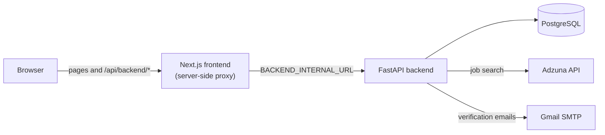

# JayPilot AI

JayPilot AI is a full-stack job-matching platform. A job seeker uploads a resume, the app extracts a structured profile from it, searches real U.S. job listings, and shows how the resume overlaps with each listing, with the reasoning visible rather than hidden behind a score.

I built it as a portfolio project to practice the whole lifecycle of a web application: a typed React frontend, a Python API backed by PostgreSQL, authentication, containerization, automated checks and image publishing.

> **Status:** active portfolio project. It runs locally with Docker Compose. There is no live public deployment linked from this repository (see [AWS deployment](#cicd-and-aws-deployment)).

## Table of contents

- [Key features](#key-features)
- [Technology stack](#technology-stack)
- [Architecture](#architecture)
- [Screenshots](#screenshots)
- [Running locally with Docker Compose](#running-locally-with-docker-compose)
- [API overview](#api-overview)
- [CI/CD and AWS deployment](#cicd-and-aws-deployment)
- [Challenges and lessons learned](#challenges-and-lessons-learned)
- [Future improvements](#future-improvements)

## Key features

**Resume analysis**
- Upload a PDF or DOCX resume (5 MB limit) and extract its text.
- Rule-based extraction builds a candidate profile: skills, education, work experience, certifications and suggested job areas. This is deterministic pattern matching, not a machine-learning model.

**Job search and matching**
- Searches U.S. job listings through the [Adzuna API](https://developer.adzuna.com/). Results are normalized so the frontend does not depend on Adzuna's response format, and apply links are Adzuna's own redirect URLs.
- Scores each listing from 0 to 100 against the candidate profile using an explainable formula:

  | Component | Weight | Based on |
  |---|---|---|
  | Skills | 60 | Skills in the listing that also appear in the resume, with common aliases normalized (for example AWS and Amazon Web Services) |
  | Job title | 20 | Overlap between the listing title and the resume's roles and suggested areas |
  | Experience | 10 | Role terms from the resume that appear in the listing |
  | Education | 10 | Degree level and certifications, when the listing mentions them |

- Each result lists matched skills, "potential gaps" (skills the listing mentions that were not detected in the resume) and plain-language reasons. The score estimates text overlap. It does not judge whether someone is qualified, and it does not use an external language model.
- Adzuna's search endpoint returns a short snippet of each description, so matching works on that snippet and a listing with little detail scores conservatively.

**Accounts and tracking**
- Registration and sign-in with bcrypt password hashing and JWT access tokens.
- Email verification with a six-digit code: the code is stored only as an HMAC hash, expires after 10 minutes, allows five incorrect attempts, and can be resent after a 60-second cooldown. Unverified accounts cannot sign in.
- Save jobs from search results, and move each one through an application pipeline: saved, applied, interview, offer, rejected. Saved jobs and statuses persist in PostgreSQL.
- Every saved-job query is filtered by the authenticated user, so one user cannot read or change another user's data.
- A signed-in dashboard with saved and application counts, a profile summary and recommended jobs.

**Email verification status:** the verification logic is covered by automated tests, and the Gmail SMTP connection accepted test messages. Delivery to a real inbox depends on your own SMTP credentials and your provider's filtering, so check it in your own environment.

## Technology stack

| Area | Technology |
|---|---|
| Frontend | Next.js 16, React 19, TypeScript, Tailwind CSS 4 |
| Backend | Python 3.12, FastAPI, Pydantic, SQLAlchemy 2, Uvicorn |
| Database | PostgreSQL 16 |
| Authentication | bcrypt, JWT (python-jose) |
| Resume parsing | PyMuPDF (PDF), python-docx (DOCX) |
| External services | Adzuna Jobs API, Gmail SMTP |
| Testing | pytest, ESLint, TypeScript compiler |
| Containers | Docker, Docker Compose, multi-stage builds, non-root runtime users |
| CI/CD | GitHub Actions, GitHub Container Registry (GHCR) |
| Target host | AWS EC2 (Amazon Linux 2023, t3.micro) |

## Architecture



The browser only talks to the Next.js server. API calls go to `/api/backend/...`, which the frontend forwards to FastAPI using a backend address read at runtime. Because the address is not compiled into the image, the same image works in local development, Docker Compose and a server, and the browser needs no CORS configuration. In the production Compose file the database sits on an internal network with no published port.

```
backend/
  main.py                 app setup, job search, matching and resume endpoints
  routers/                auth and saved-jobs routers
  services/               resume analyzer, job matcher, Adzuna client, email, auth helpers
  migrations/             versioned schema migration
  tests/                  pytest suite for email verification
frontend/
  app/                    pages: landing, sign in, sign up, verify email, dashboard
  lib/                    API client helpers (auth, saved jobs)
compose.yaml              local stack (builds images)
compose.prod.yaml         production stack (pulls prebuilt images)
.github/workflows/        ci.yml and publish-images.yml
```

## Screenshots

Screenshots will be added to `docs/screenshots/`. Planned images:

| Screen | Placeholder |
|---|---|
| Landing page | _Screenshot to be added_ |
| Create account and email verification | _Screenshot to be added_ |
| Resume upload and candidate profile | _Screenshot to be added_ |
| Job search results with match details | _Screenshot to be added_ |
| Saved jobs | _Screenshot to be added_ |
| Application tracker | _Screenshot to be added_ |

## Running locally with Docker Compose

**Prerequisites:** Docker with the Compose plugin, and an [Adzuna developer account](https://developer.adzuna.com/) for the job-search keys. A Gmail address with an App Password is only needed if you want verification emails to send.

1. Clone the repository.

   ```bash
   git clone https://github.com/Jbaah007/JayPilot-AI.git
   cd JayPilot-AI
   ```

2. Create the two environment files from the examples. Both are ignored by Git.

   ```bash
   cp .env.example .env
   cp backend/.env.example backend/.env
   ```

3. Fill in the values.
   - In `.env`, set `POSTGRES_PASSWORD` to a unique value.
   - In `backend/.env`, set `ADZUNA_APP_ID` and `ADZUNA_APP_KEY`, and set `JWT_SECRET_KEY` to a long random string (the example file shows a command that generates one).
   - To send verification emails, also set `SMTP_USERNAME`, `SMTP_PASSWORD` (a Google App Password) and `SMTP_FROM_EMAIL`. The `DATABASE_URL` line is only used when running the backend outside Docker, because Compose supplies its own database settings.

4. Build and start the stack.

   ```bash
   docker compose up -d --build
   ```

5. Open the app.
   - Frontend: http://localhost:3001
   - API documentation (FastAPI/OpenAPI): http://localhost:8001/docs

Without SMTP credentials the app still runs, but account creation cannot send the verification code. The account stays unverified and cannot sign in.

To stop the stack, run `docker compose down`. Database records live in a named Docker volume and survive restarts. Adding `-v` would delete that volume, so avoid it unless you want a clean database.

**Backend tests** need a PostgreSQL database and the same variables the application reads. The CI workflow shows a working setup, and with the dependencies from `backend/requirements.txt` and `backend/requirements-dev.txt` installed, the command is `python -m pytest tests`. SMTP is mocked in the tests, so they send no email.

## API overview

| Method and path | Purpose | Auth |
|---|---|---|
| `GET /health` | Health check | No |
| `POST /auth/register` | Create an unverified account and send a code | No |
| `POST /auth/verify-email` | Verify the email with the six-digit code | No |
| `POST /auth/resend-verification` | Request a new code (generic response) | No |
| `POST /auth/login` | Sign in and receive a token (verified accounts only) | No |
| `GET /auth/me` | Current user | Yes |
| `POST /resume/upload` | Extract text and a candidate profile from a PDF or DOCX | No |
| `GET /jobs/search` | Search Adzuna listings | No |
| `POST /jobs/match` | Search and score listings against a candidate profile | No |
| `POST /saved-jobs`, `GET /saved-jobs` | Save a job, list saved jobs | Yes |
| `GET /saved-jobs/summary` | Counts for the dashboard | Yes |
| `PATCH /saved-jobs/{id}/status` | Move a job through the pipeline | Yes |
| `DELETE /saved-jobs/{id}` | Remove a saved job | Yes |

The resume upload and job search endpoints do not require sign-in. Resume files are processed in memory and the extracted profile is held in the browser session, not stored in the database.

## CI/CD and AWS deployment

### GitHub Actions

Two workflows live in `.github/workflows/`:

- **`ci.yml`** runs on pushes and pull requests to `main`:
  - Backend: Python 3.12 with a throwaway PostgreSQL 16 service, dependency install, byte-compilation and the pytest suite. Test secrets are generated at run time, and SMTP is mocked.
  - Frontend: `npm ci`, ESLint, TypeScript checks and a production build.
  - Docker: builds both images without pushing and validates the Compose file with placeholder values.
- **`publish-images.yml`** builds the backend and frontend images for `linux/amd64` and pushes them to GitHub Container Registry, tagged `latest` and with the short commit SHA. It uses the built-in `GITHUB_TOKEN` with only `contents: read` and `packages: write`. It publishes images and does not deploy them.

I ran each CI step locally against clean copies of the tracked files before relying on the workflows. Both images have been published to GHCR.

### AWS EC2

`compose.prod.yaml` is written for a single small server, an EC2 t3.micro (1 GB RAM) running Amazon Linux 2023:

- It pulls the prebuilt GHCR images and never builds on the server, which saves memory and disk.
- Only the frontend publishes a port. The backend is reachable only from the frontend container.
- PostgreSQL has no published port and sits on an internal network with no route to the internet. Data persists in a named volume.
- Containers have memory limits, PostgreSQL settings are tuned down for 1 GB, and logs are rotated.
- Secrets come from `.env` files on the server, not from the images or the repository.

This repository does not link to a running deployment, and deployment is not automated. Before real use, the server would need a swap file, a way to authenticate to GHCR (or public packages), and HTTPS in front of the app.

## Challenges and lessons learned

- **Browser and container networking.** `localhost` means something different inside a container. I moved API calls behind a same-origin proxy in Next.js whose target is read at runtime, which removed a build-time URL and the need for CORS.
- **A password-hashing library mismatch.** `passlib` 1.7.4 does not work with the installed `bcrypt` 5, so I call `bcrypt` directly.
- **Changing a live schema safely.** Adding email verification meant existing accounts had to keep working. A versioned migration marks pre-existing users as verified, while new accounts start unverified.
- **A CI failure I would not have seen locally.** TypeScript failed on a clean checkout because Next.js generates route types that are gitignored. Running each step on a clean copy found it, and the workflow now runs `next typegen` first.
- **Debugging silent failures.** Resend returns the same response whether or not an account exists, to avoid revealing registered emails, which also hid failures. I added structured logs that record the outcome and an error category without recording codes, addresses or credentials. I also found that two copies of the stack were running at once, so requests were reaching an outdated backend. Checking which process served a request would have been faster than reasoning about the code.
- **Honest scoring.** Adzuna returns only a snippet of each listing, so match scores are limited by that text. I kept the formula simple and visible and described the score as overlap, not suitability.
- **Secrets hygiene.** I audited what Git would include before the first push, tightened `.gitignore`, kept examples to placeholders, and used generated throwaway secrets in CI.

## Future improvements

- Put the app behind HTTPS with a reverse proxy, then automate deployment to EC2.
- Replace `localStorage` token storage with httpOnly cookies, and add per-IP rate limiting.
- Move from the hand-written migration to a full migration tool such as Alembic.
- Persist resumes and profiles per user so they survive a page reload.
- Add frontend and end-to-end tests, and broaden backend test coverage beyond email verification.
- Switch to a transactional email provider such as Amazon SES for production mail.
- Improve extraction and matching (richer skill taxonomy, seniority and location signals) and add pagination and filters to job search.
- Add monitoring and health dashboards for the deployed stack.